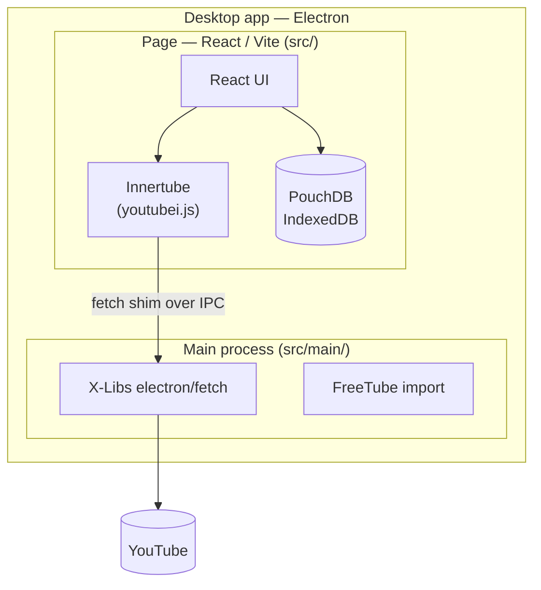

# X-Stream — Development Guide

## Overview

X-Stream is a free, open source, privacy-respecting YouTube client. It allows users to browse and watch YouTube content without being tracked by Google.

---

## Architecture

X-Stream ships as a **self-contained Electron desktop app** built with electron-vite. The React UI (`src/`) runs as the page in the window, talks to YouTube through youtubei.js, and stores its data in PouchDB. The main process (`src/main/`) provides the window, the requests the page's cross-origin rules would block, and the FreeTube import, over a bridge from X-Libs (`src/shared/bridge.ts`).

### System diagram



### Layer responsibilities

| Layer | What runs there |
|-------|----------------|
| **Page** (`src/`) | React UI, youtubei.js, PouchDB — the whole app |
| **Main process** (`src/main/`, `src/preload/`) | Window, YouTube requests (CORS bypass), FreeTube import |

### Key design points

- **youtube.js runs in the page.** The app has no server; YouTube data is fetched by the page.
- **CORS is bypassed in the main process, not by header rewriting.** `desktop_fetch` (`src/utils/desktop.ts`) hands each request to the main process over the bridge, which sends it with Node's fetch to the hosts in `YOUTUBE_HOSTS` only. The single seam is `Innertube.create({ fetch })` in `src/plugins/youtubejs/innertube.ts`.
- **`Origin` must be pinned, not stripped.** InnerTube answers `403` to any cross-origin `Origin` value (an empty one included), so `desktop_fetch` sets `Origin`/`Referer` to `https://www.youtube.com`. See `tests/desktop_fetch.test.ts`.
- **Adaptive streams go through the main process too, streamed.** `googlevideo.com` returns no `Access-Control-Allow-Origin`, so the SABR adapter (`src/services/shakaAdapter.ts`) sends its segment requests through `desktop_stream_fetch`: the main process answers the head over the bridge (`http_stream`) and pushes the body as `stream_chunk` events, which the page turns into the Response's `ReadableStream`.
- **The IOS Innertube client is used for playback.** It is the only one returning stream URLs that need no signature deciphering — WEB/ANDROID/TV all require running YouTube's player script in a JS evaluator we don't ship.
- **Cached data is only refetched when stale.** Each channel cache carries a
  `fetchedAt`; `getStaleChannelIds()` filters to expired entries (30 min TTL) so
  revisiting the feed is a pure DB read. Refreshing all 32 channels on every visit
  was the single largest page-load cost.
- **Thumbnails are URLs, never inlined.** They used to be downloaded and stored as
  base64, costing 256 requests per feed refresh and leaving a ~75 MB database that
  slowed every query. `` fetches only what is on screen.
  `stripInlinedThumbnails()` migrates existing data on startup.
- **Channel uploads are paginated.** YouTube returns 30 videos per response;
  `getChannelVideos()` follows continuations (capped at 100 pages) and reports each
  page so the grid fills progressively.
- **Native capabilities live in the main process.** The FreeTube importer needs filesystem access the page lacks, so it is a bridge method in `src/main/freetube.ts`. Pages feature-detect via `is_desktop()` and degrade gracefully without it.
- **The built page loads from a file**, so routing uses a hash router and the CSP sits in `index.html`.

## Platform Targets

| Platform | Stack |
|----------|-------|
| Desktop | Electron + React (`src/`) → Linux / macOS / Windows |
| Mobile | React Native — planned |

---

## Directory Structure

```
X-Stream/
├── src/main/                  # Electron main process
│   ├── index.ts               # Window (X-Libs create_window) and bridge handlers
│   └── freetube.ts            # FreeTube import (filesystem access)
├── src/preload/index.ts       # Exposes the bridge as window.x_stream
├── src/shared/bridge.ts       # Bridge method table and allowed YouTube hosts
├── resources/icon.svg         # The app's icon; icon.png is generated from it by x-libs-icons
│
├── src/                       # React UI — the app itself (the window's page)
│   ├── App.tsx                # React Router routes + Layout shell
│   ├── theme.ts               # Light / dark / system theme kept in the settings
│   ├── components/            # The app's own UI (Layout, VideoCard, ChannelCard, PageLayout, SabrPlayer, Comments)
│   ├── pages/                 # Search, Watch, Channel, Subscriptions, Channels, History, Settings
│   ├── plugins/               # Plugin system (youtubejs)
│   ├── db/                    # PouchDB access layer (browser)
│   ├── utils/desktop.ts       # Desktop detection, fetch shim, native calls
│   ├── services/ types/
│   └── …
│
├── electron.vite.config.ts    # Main, preload and page builds
├── shell.nix                  # Nix dev shell: Node 24, Electron
├── flake.nix                  # Nix flake
└── package.nix                # Nix package definition
```

---

## Tech Stack

| Concern | Technology |
|---------|-----------|
| YouTube data | youtubei.js 18 |
| Client UI | React 19 |
| Adaptive playback | shaka-player 4 + googlevideo SABR (MSE) |
| Desktop shell | Electron, built with electron-vite |
| Shared code | `@x-tech-laboratories/x-libs` (bridge, window, fetch, React widgets) |
| Look | `@x-tech-laboratories/halon` stylesheets and tokens |
| React bundler | Vite 8 |
| React routing | React Router 7 |
| React testing | Vitest + Testing Library |
| Linting | oxlint |
| Dev environment | Nix (flake + shell.nix) |

---

## Running Locally

```bash
# Enter Nix dev shell (provides Node 24, Electron)
nix-shell

# Run the desktop app
npm install && npm run dev
```

---

## Features

### Playback
- Adaptive playback up to 2160p over SABR with shaka-player — YouTube only muxes video+audio to 360p, so higher qualities arrive as separate streams
- Quality dropdown overlaid on the player (Auto + every available resolution)
- Fullscreen toggle (button or double-click)
- Quality selection from available streams
- Watch page: title, channel link, subscribe button, view count, collapsible description
- YouTube cookie auth (Settings → YouTube Account): paste session cookie to unlock 720p+ adaptive streams via youtube.js

### Search & Browse
- Universal topbar: video URL → Watch, channel URL → Channel page, search term → results
- Search results with thumbnail, duration, channel name (linked), view count
- Previously-watched indicator on search results (normal / dim / hide, per Settings)
- Channel page: avatar, name, subscriber count, collapsible description, subscribe button
- Channel page tabs: Videos and Playlists
- Previously-watched indicator on channel video grid

### Subscriptions
- Subscribe / unsubscribe from Watch page and Channel page
- Subscriptions stored in PouchDB; sorted alphabetically
- **Subscriptions feed** (`/subscriptions`): recent videos from all subscribed channels
- **Channels grid** (`/channels`): card grid of subscribed channels

### Watch History
- Every watched video is recorded to PouchDB
- History page: responsive grid, relative timestamps, per-video remove, clear all
- Previously-watched video style (Normal / Dim / Hide) in Settings

### Data Import
- **FreeTube import** (desktop only): imports subscriptions and watch history

### Settings
- System / light / dark theme, also from the top bar's button
- Startup page (Subscriptions / Channels / History)
- Previously watched video style (Normal / Dim / Hide)
- YouTube session cookie: stored in PouchDB, restored on startup

---

## Privacy Model

_To be defined._

---

## Roadmap

### Phase 1 — Foundation ✓
- [x] Nix dev environment (flake, shell.nix, package.nix)
- [x] Vite + React + TypeScript scaffold
- [x] React Router with page skeleton
- [x] PouchDB data layer + types
- [x] Settings stored in PouchDB (theme, quality, privacy mode)
- [x] Light / dark theme toggle
- [x] Desktop shell skeleton

### Phase 2 — Plugin System ✓
- [x] `VideoPlugin` interface
- [x] `PluginManager` with registration, lookup, and auto-select
- [x] yt-dlp plugin (later removed)
- [x] VideoPlayer component with quality selector
- [x] Watch page wired to active plugin

### Phase 3 — youtube.js Plugin ✓
- [x] youtube.js plugin — runs in the page; CORS bypassed by fetching from the desktop shell
- [x] YouTube cookie auth for 720p+ adaptive streams
- [x] Plugin selector in Settings page

### Phase 4 — Search & Browse ✓
- [x] Topbar search (URL → Watch, query → Search results)
- [x] Search results page with thumbnail, duration, channel
- [x] Channel page with avatar, subscriber count, subscribe button
- [x] Channel page Videos and Playlists tabs

### Phase 5 — Subscriptions & History ✓
- [x] Subscribe / unsubscribe
- [x] Subscriptions stored in PouchDB
- [x] Subscription feed and Channels grid pages
- [x] Watch history stored in PouchDB
- [x] History page with grid, timestamps, remove, clear all
- [x] Previously-watched style setting

### Phase 6 — Data Import ✓ (partial)
- [x] FreeTube import (subscriptions + watch history, Desktop only)
- [ ] OPML / CSV subscription export
- [ ] Generic watch history export

### Phase 6.5 — UI Component System ✓
- [x] Centralised `Button`, `MenuButton`, `ToggleButton`, `VideoCard`, `VideoThumbnail` components
- [x] `src/utils/format.ts` — shared `formatDuration` + `timeAgo`
- [x] `src/services/videoCache.ts` — stale-while-revalidate cache

### Phase 7 — REST API Server (removed)
- [x] Fastify server in `server/` — video, channel, subscriptions, history, settings, proxy, sync routes
- [x] PouchDB (LevelDB) persistence on server
- [x] Innertube singleton on server (no CORS, no workarounds)
- [x] Optional API key authentication
- [x] Image proxy endpoint (`/api/proxy`)
- [x] PouchDB → CouchDB sync endpoint (`/api/sync`)
- [x] Health check endpoint

### Phase 8 — Tauri Desktop App ✓
- [x] Tauri shell (`src-tauri/`) hosting the React UI — replaced the Electron shell
- [x] All pages: Search, Watch, Channel, Subscriptions, Channels, History, Settings
- [x] FreeTube import as a Rust command (`src-tauri/src/freetube.rs`)
- [x] youtube.js is the client's only backend; yt-dlp and Capacitor removed
- [x] Adaptive DASH playback up to 2160p (dash.js + `ytstream://` segment proxy)
- [x] Custom player controls: play/pause, seek with buffer indicator, volume,
      speed, quality, fullscreen, and keyboard shortcuts
- [x] Home page removed; startup page is configurable in Settings
- [x] Channel pages load every video via continuations, not just the first 30
- [x] Video card overflow menu: mark as watched, open in YouTube, copy link
- [x] Channel about text always visible (no longer collapsed)
- [x] Feed caching with a TTL; thumbnails stored as URLs (DB ~75 MB → <1 MB)
- [x] `Origin`/`Referer` pinning so InnerTube stops answering 403

### Phase 8.5 — Electron on the X-Tech standard (in progress)
- [x] Electron via electron-vite, on X-Libs' bridge, window and fetch helpers
- [x] FreeTube import in the main process (`src/main/freetube.ts`)
- [x] Node 24, TypeScript 7, GPL-3.0-or-later, CI workflow
- [x] Pages on X-Libs' widgets and Halon
- [x] Delete the Tauri shell and its icons

### Phase 9 — Production Hardening
- [ ] Package installers (AppImage / deb / dmg / msi) for the Electron app
- [ ] Mobile app in React Native
- [ ] Verify 1080p+ playback end to end in the app window
- [ ] Privacy mode (no history stored)
- [ ] Default quality preference
- [ ] P2P sync between devices via PouchDB replication
